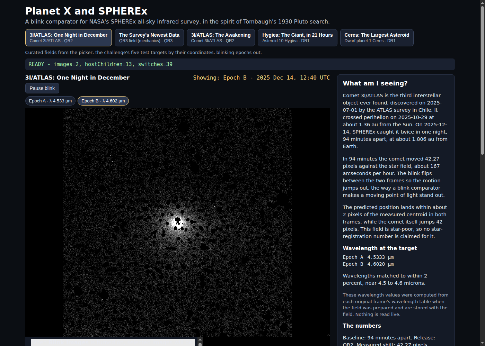

# Planet X and SPHEREx

RiverHacks x NASA Space Apps 2026 — a SPHEREx epoch blink viewer.

**Live demo: https://planet-x-spherex.vercel.app**

## What it does

A blink comparator for NASA's SPHEREx all-sky infrared survey, in the
spirit of Tombaugh's 1930 Pluto search. Pick a field and the viewer
flips between two epochs of the same patch of sky: the stars hold
still, and anything that moved — a comet, an asteroid — jumps out.
A pair only counts when the wavelength at the object's own pixel
matches within 2% between the two frames; pairs that fail that rule
are refused, and the refusals are shown, not hidden. A timeline steps
through each field's epochs, a plain-words panel explains what you
are seeing, and a coordinate panel reports measured results for the
challenge's five official test targets.

## The five fields

- **3I/ATLAS: One Night in December** — comet 3I/ATLAS (QR2), two
  frames 94 minutes apart on 2025-12-14; the comet moved 42.27 px.
- **The Survey's Newest Data** — the QR3 mechanics field; step
  through it by hand. No mover is claimed for this field.
- **3I/ATLAS: The Awakening** — the same comet 135 days apart: a
  measured non-detection in August 2025, a clear detection in
  December.
- **Hygiea: The Giant, in 21 Hours** — asteroid 10 Hygiea (DR1),
  a pair 21.12 hours apart with a 68.01 px shift.
- **Ceres: The Largest Asteroid** — dwarf planet 1 Ceres (DR1),
  the strongest signal on the slate.

## Run locally

`npm install`, then `npm run dev` (Vite). The FITS field data is
staged locally and is not committed (see below), so the viewer runs
fully where the data bundle is present.

Built by Kenichi Nishimura (solo competitor) with disclosed AI assistance.
The field preparation and audit work was done by K3N1, an AI agent working
from the competitor's design, and the results were red-teamed by an outside
panel of other AI models. Data: NASA/IRSA SPHEREx archive (Quick Release 2,
Quick Release 3, Data Release 1). Ephemerides: JPL Horizons.

This publication makes use of data products from the Spectro-Photometer for
the History of the Universe, Epoch of Reionization and Ices Explorer
(SPHEREx), which is a joint project of the Jet Propulsion Laboratory and the
California Institute of Technology, and is funded by the National
Aeronautics and Space Administration.

Blink viewer: JS9 v3.9.0 (Smithsonian Astrophysical Observatory), vendored
under public/js9 from the official npm distribution. SPHEREx FITS field data
is staged locally under public/data (SHA-256-verified against the field
slate manifest) and is not committed. Wavelength values shown in the app
were computed from each original frame's wavelength table during field
preparation and are stored in src/fields.json; nothing is read live.
